# 第4—6章知识点待审核稿
状态：待用户审核；不得合并、部署或设置生产班级进度。
来源：2026教材 PDF及2026-11-11第2—6章全可编辑版；正文使用教材原句，中文标点、空格和分数排版作显示规范化。
核对：52项可直接与教材PDF文本规范化匹配；4项含栅格公式/竖式分数（ch4-4、ch4-8、ch6-5、ch6-17）对照教材页面人工核对。P163平角、周角恢复教材图号与原句句号；ASCII示意图全部替换为教材原图。
绿色候选填空与原图完整审核版：[chapters-4-6-review.html](chapters-4-6-review.html)。HTML离线可打开，不连接生产系统。

## 4.1 等式与方程

### ch4-1 · 等式 · P106

像2x=3y，S=xy，12a+3b=58这样，表示{相等关系}的式子叫作{等式}（equation）。

### ch4-2 · 等式的基本性质 · P107

1. 等式两边都{加上（或减去）}{同一个数或整式}，所得结果仍是{等式}。

### ch4-3 · 等式的基本性质 · P107

2. 等式两边都{乘（或除以）}{同一个数}（{除数不能为0}），所得结果仍是{等式}。

### ch4-4 · 等式的基本性质 · P107

用字母可以表示为：
如果 a=b，那么 {a±m=b±m}；
如果 a=b，那么 {am=bm}；
如果 a=b，且 {m≠0}，那么 {a/m=b/m}。

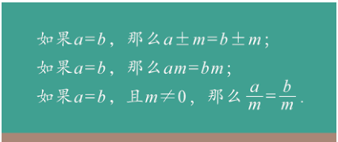

### ch4-5 · 未知数 · P109

在上面的等式中，都是用字母表示要求的{未知的量}，这样的字母叫作{未知数}（unknown number）。解决上述问题的关键是求出未知数的值。

### ch4-6 · 方程 · P109

像2x+1=x+5，a+b=12，2a+b=20，0.618x²=1.6这样，{含有未知数的等式}叫作{方程}（equation）。

### ch4-7 · 方程的解与解方程 · P111

能使方程{两边的值相等}的未知数的值叫作{方程的解}（solution of equation），如x=4是方程2x+1=5+x的解。求方程的解的过程叫作{解方程}（solving equation）。

## 4.2 一元一次方程及其解法

### ch4-8 · 一元一次方程 · P113

在上一节认识的方程中，像2x+1=x+5，x+1/7x=19这样，等号两边都是{整式}，且只含有{一个未知数}，未知数的次数都是{1}的方程，叫作{一元一次方程}（linear equation with one unknown）。

### ch4-9 · 移项 · P115

像这样，方程中的某些项{改变符号}后，可以从方程的一边移到{另一边}，这样的变形叫作{移项}（moving terms）。

### ch4-10 · 移项 · P115

在解一元一次方程时，移项的目的是把{含有未知数的项}移到方程的{一边}，把{常数项}移到{另一边}。

### ch4-11 · 解一元一次方程 · P115

解一元一次方程就是通过{变形}，最终将方程转化为{x=c}（c为常数）的形式。

### ch4-12 · 解一元一次方程——去括号 · P116

在解一元一次方程时，如果方程中有括号，为了将方程转化为{x=c}（c为常数）的形式，一般需要先根据{去括号法则}{去括号}。

### ch4-13 · 解一元一次方程的步骤 · P118

一般地，解一元一次方程的步骤是：{去分母}、{去括号}、{移项}、{合并同类项}、{把未知数的系数化为1}。通过这些步骤可以将一元一次方程转化为x=c（c为常数）的形式。

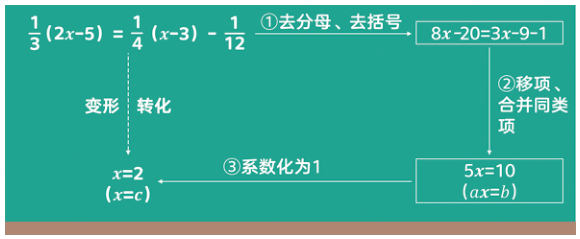

## 5.1 观察 抽象

### ch5-1 · 多面体 · P141

多面体是由{若干个面}围成的{封闭图形}，相邻两个面的公共边称为{棱}，棱与棱的交点称为{顶点}。

### ch5-2 · 点、线、面 · P141

{点}（point）、{线}（line）、{面}（surface）是构成几何体的{基本要素}。

## 6.1 直线、射线、线段

### ch6-1 · 两点确定一条直线 · P154

{两点}确定{一条直线}。

### ch6-2 · 两点之间，线段最短 · P156

两点之间的所有连线中，{线段}{最短}。
简单说成：两点之间，线段最短。

### ch6-3 · 两点之间的距离 · P156

两点之间{线段的长度}叫作这两点之间的{距离}（distance）。

### ch6-4 · 中点 · P159

如果一个点把一条线段分成{两条相等的线段}，那么这个点叫作这条线段的{中点}（middle point）。

### ch6-5 · 中点 · P159

如图，如果C是线段AB的{中点}，
那么 {AC=BC=½AB} 或 {AB=2AC=2BC}。

## 6.2 角

### ch6-6 · 角 · P162

有{公共端点}的{两条射线}组成的图形叫作{角}（angle），这个公共端点是角的{顶点}，这两条射线是角的两条{边}。

### ch6-7 · 始边和终边 · P163

如图6-14，角也可以看成是一条{射线}绕着它的{端点}{旋转}到另一个位置所成的图形。起始位置和终止位置的射线分别叫作角的始边和终边。

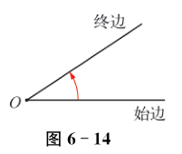

### ch6-8 · 平角与周角 · P163

如图6-15（1），当角的终边和始边成{一条直线}时，这个角叫作{平角}。如图6-15（2），当角的终边{旋转一周}后与始边重合时，这个角叫作{周角}。

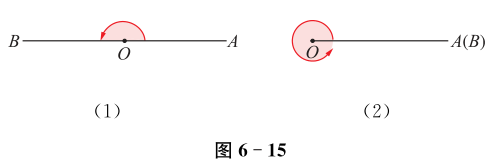

### ch6-9 · 角度制 · P163

角的度量一般采用{角度制}，常用的{度}量单位是度、{分}、{秒}，分别用“°”“′”“″”表示，其中1°={60′}，1′={60″}。

### ch6-10 · 等角 · P163

如果两个角的{度数相等}，那么就称这两个角相等，简称{等角}。两个等角可以{重合}，可以重合的角也都相等。

### ch6-11 · 周角、平角、直角 · P163

一个周角等于{360°}，一个平角等于{180°}，一个直角等于{90°}。

### ch6-12 · 补角 · P165

如果两个角的度数之和等于{180°}，那么这两个角互为{补角}（supplementary angle），简称{互补}。例如，∠1=60°，∠2=120°，则∠1和∠2互为补角。

### ch6-13 · 余角 · P165

如果两个角的度数之和等于{90°}，那么这两个角互为{余角}（complementary angle），简称{互余}。例如，∠3=20°，∠4=70°，则∠3和∠4互为余角。

### ch6-14 · 同角（等角）的补角相等 · P165

{同角（等角）}的{补角}{相等}。

### ch6-15 · 同角（等角）的余角相等 · P165

{同角（等角）}的{余角}{相等}。

### ch6-16 · 角的平分线 · P168

如果从角的{顶点}出发的一条{射线}把这个角分成{两个相等的角}，那么这条射线叫作这个角的{平分线}（angular bisector）。

### ch6-17 · 角的平分线 · P168

如图，如果OC是∠AOB的{平分线}，
那么 {∠AOC=∠BOC=½∠AOB}，
或 {∠AOB=2∠AOC=2∠BOC}。

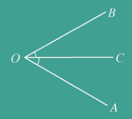

## 6.3 相交线

### ch6-18 · 对顶角 · P171

两条直线相交所成的四个角中，有{公共顶点}没有{公共边}的两个角叫作{对顶角}（opposite angles）。在图6-25中，∠1和∠3是对顶角，∠2和∠4也是对顶角。

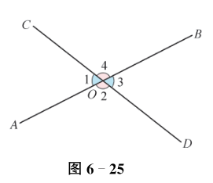

### ch6-19 · 对顶角相等 · P171

{对顶角}{相等}。

### ch6-20 · 垂直 · P173

如果两条直线相交所成的四个角中有一个角是{直角}，那么就称这两条直线{互相垂直}，其中的一条直线叫作另一条直线的{垂线}（perpendicular line），它们的交点叫作{垂足}（foot of a perpendicular）。

### ch6-21 · 垂直 · P173

在图6-29中，两条直线互相垂直，记作“{a⊥b}”或“{AB⊥CD}”，垂足是{O}。

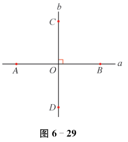

### ch6-22 · 垂直 · P174

在{同一平面内}，过一点{有且只有一条}直线与已知直线{垂直}。

### ch6-23 · 垂线段 · P176

如图6-35，过直线l外一点P作l的{垂线}，{垂足}为O，线段PO叫作点P到直线l的{垂线段}（vertical line segment）。

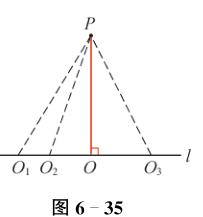

### ch6-24 · 垂线段最短 · P176

直线外一点与直线上各点连接的所有线段中，{垂线段}{最短}。

### ch6-25 · 点到直线的距离 · P177

直线外一点到这条直线的{垂线段的长度}叫作{点到直线的距离}。例如，在图6-35中，垂线段PO的长度就是点P到直线l的距离。直线上的点到这条直线的距离为{0}。

## 6.4 平行线

### ch6-26 · 平行线 · P180

在{同一平面内}，{不相交}的两条直线叫作{平行线}（parallel lines）。

### ch6-27 · 平行线 · P180

在图6-38中，a，b两条直线互相平行，记作“{a∥b}”或“{AB∥CD}”。

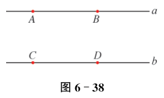

### ch6-28 · 平行线基本事实1 · P181

过{直线外一点}{有且只有一条}直线与这条直线{平行}。

### ch6-29 · 同位角 · P183

如图6-45，两条直线a，b被第三条直线c所截，形成{八个角}。具有{∠1和∠2}这种位置关系的一对角叫作{同位角}（corresponding angles）。在图6-45中，∠3和∠4，∠5和∠6，∠7和∠8分别是同位角。

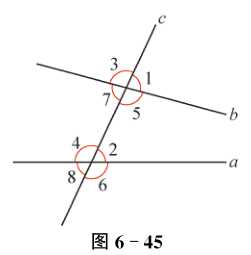

### ch6-30 · 平行线基本事实2 · P183

两条直线被第三条直线所截，如果{同位角相等}，那么这两条直线{平行}。（简单说成：同位角相等，两直线平行。）

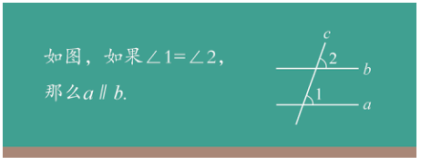

### ch6-31 · 内错角与同旁内角 · P185

如图6-49，具有{∠4和∠5}这种位置关系的一对角叫作{内错角}（alternate interior angles），具有{∠2和∠5}这种位置关系的一对角叫作{同旁内角}（interior angles on the same side）。

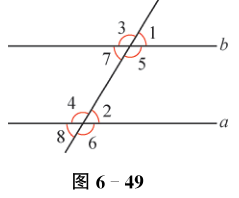

### ch6-32 · 平行线的判定定理 · P186

两条直线被第三条直线所截，如果{内错角相等}，那么这两条直线{平行}。（简单说成：内错角相等，两直线平行。）

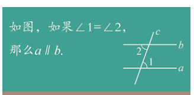

### ch6-33 · 平行线的判定定理 · P186

两条直线被第三条直线所截，如果{同旁内角互补}，那么这两条直线{平行}。（简单说成：同旁内角互补，两直线平行。）

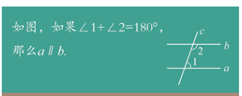

### ch6-34 · 平行线的性质定理1 · P188

两条{平行直线}被第三条直线所截，{同位角相等}。（简单说成：两直线平行，同位角相等。）

### ch6-35 · 平行线的性质定理2 · P188

两条{平行直线}被第三条直线所截，{内错角相等}。（简单说成：两直线平行，内错角相等。）

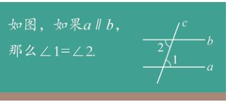

### ch6-36 · 平行线的性质定理2 · P188

两条{平行直线}被第三条直线所截，{同旁内角互补}。（简单说成：两直线平行，同旁内角互补。）

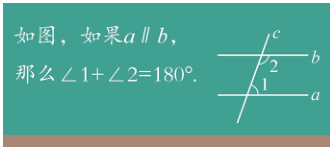

## 6.5 多边形

### ch6-37 · 多边形 · P193

在平面内，由{不在同一条直线上}的{三条或三条以上}的线段{首尾顺次相接}组成的图形叫作{多边形}（polygon）。这些线段叫作多{边}形的边（side），线段的公共端点叫作多边形的{顶点}（vertex）。

### ch6-38 · 内角与外角 · P193

多边形{相邻两边}组成的角叫作多边形的{内角}（inner angle），多边形的边与它邻边的{延长线}组成的角叫作多边形的{外角}（external angle）。

### ch6-39 · 多边形的外角与内角 · P194

多边形的外角与{相邻的内角}{互为补角}。

### ch6-40 · 对角线 · P194

连接多边形{不相邻}的两个顶点的线段叫作多边形的{对角线}（diagonal）。

### ch6-41 · 正多边形 · P194

和正方形类似，{各边相等}、{各内角也相等}的多边形叫作{正多边形}（regular polygon）。

